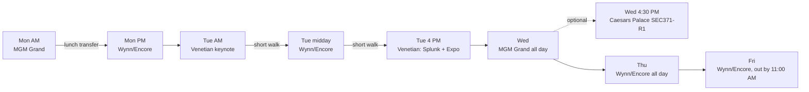

# AWS re:Invent 2026 — Session Plan (low-walking, with backups)

As of 2026-11-13. Source: `reinvent_2026_all_sessions.xlsx`, exported 2026-11-12 23:16 UTC (2,567 sessions). All times are Las Vegas local.

## How this plan works

Three days at Wynn/Encore, one and a half at MGM Grand. One cross-campus transfer all week (Monday lunch) and two short walks on Tuesday. Friday ends at 11:00 AM for a 2:00 PM flight.

- **Why these venues.** Security sits at Wynn/Encore (97 of 104 SEC sessions on Thursday). Networking sits at MGM Grand (55 of 78 NET sessions). MGM is the far end of campus, so it gets its own day.
- **Seat data.** In the Nov 12 export, 682 of 692 chalk talks, 300 of 302 workshops, 259 of 260 builders' sessions and all 127 code talks show 0 seats and 0 waitlist. All 543 breakouts and 258 lightning talks show full capacity. The export cannot distinguish "fully reserved" from "not reservable", so check the portal. Until then, treat every small-format pick as walk-up and arrive 15 to 20 minutes early.
- **Reading the tables.** Preferred is the pick. Option 1 and Option 2 are fallbacks in the same building at about the same time. *(open)* means free seats in the export.

## Monday, Nov 30 — MGM Grand morning, Wynn/Encore afternoon

| Time | Venue | Preferred | Option 1 | Option 2 |
| --- | --- | --- | --- | --- |
| 8:30–9:30 AM | MGM Grand | **NET327** Connectivity strategies across AWS Partitions, breakout *(open)* | NET215-R Choosing the right AWS connectivity solution, chalk talk | SEC215-S Runtime cloud security (Upwind), breakout *(open)* |
| 10:00–11:00 AM | MGM Grand | **NET305-R** Enforce encryption in transit with VPC Encryption Controls, builders' session | NET217-R Designing health checks that matter, chalk talk | SEC232-S Secure AI agents with AgentCore (Okta), 10:30 breakout *(open)* |
| 11:00 AM–1:15 PM | Transfer | Lunch, then MGM Grand to Wynn/Encore | | |
| 1:30–2:30 PM | Wynn/Encore | **SEC431** Network Firewall deployment models, chalk talk (400) | SEC101-S Cloud SOC Agent (CrowdStrike), 1:00 breakout *(open)* | NET219 Private AI agent egress with VPC Lattice, 1:30 lightning talk *(open)* |
| 3:30–5:30 PM | Wynn/Encore | **COP317-R** Hands-on with AWS DevOps Agent, workshop | SEC433 Firewall policy management for regulated and legacy workloads, 4:00 code talk | COP352 DevOps Agent in financial services, 3:00 lightning talk *(open)*, then SEC386 accountable agents, chalk talk |

- The transfer is on Monday because NET327 and SEC431 each run only once.
- COP317 repeats Wednesday at MGM Grand, already the Wednesday venue.
- Expo welcome reception: 4:00–7:00 PM at the Venetian.

## Tuesday, Dec 1 — keynote, Wynn/Encore, then Splunk and the Expo

| Time | Venue | Preferred | Option 1 | Option 2 |
| --- | --- | --- | --- | --- |
| 8:30–10:30 AM | Venetian | **KEY002** CEO keynote | Skip it and start the day at Wynn/Encore | |
| 10:30 AM–12:00 PM | Walk | Venetian to Wynn/Encore, early lunch | | |
| 12:00–2:00 PM | Wynn/Encore | **SEC315-R** Hands-on network defense with Network Firewall and Route 53 DNS Firewall, workshop | COP335 Observability for the agentic era (CloudWatch), 11:30 breakout *(open)*, then SEC364 Network Firewall at Coupang, 1:00 breakout *(open)* | SEC372 Governing hundreds of accounts with Landing Zone Accelerator, 11:30 code talk, then SEC301-R Alert to resolution, 1:00 chalk talk |
| 2:30–3:30 PM | Wynn/Encore | **SEC424-R1** Deep dive on IAM policy evaluation, chalk talk (400) | AIM244-S Solving problems faster with AI SRE (Splunk by Cisco), breakout *(open)* | NET313-R1 SD-WAN on the AWS global backbone, 3:00 chalk talk |
| 4:00–5:00 PM | Venetian | **AIM109-S** Build trust in AI with agent observability (Splunk by Cisco), breakout *(open)* | COP304 Observability and operations in the AI era, breakout at Wynn/Encore *(open)* | SEC407-R Constrain AI agents with permissions boundaries and Cedar, 3:30–5:30 workshop at Wynn/Encore |
| 5:00–6:00 PM | Venetian | Expo booths (closes 6:00 PM) | | |

- Option 1 for the workshop starts at 11:30. With no SEC315-R seat by Tuesday morning, commit to Option 1 instead of queueing.
- SEC315 repeats Friday 8:00–9:00 AM at Wynn/Encore as a one-hour version.

## Wednesday, Dec 2 — MGM Grand all day

Skips the Data & AI keynote (8:30 AM, Venetian) in favour of NET304.

| Time | Venue | Preferred | Option 1 | Option 2 |
| --- | --- | --- | --- | --- |
| 8:30–9:30 AM | MGM Grand | **NET304** Advanced VPC design and new capabilities, breakout *(open)* | COP212 Operational excellence at scale with AWS Unified Operations, 9:00 breakout *(open)* | |
| 10:30–11:30 AM | MGM Grand | **SEC430-R1** Multi-tenant isolation with IAM: ABAC, session tags, token vending machines, chalk talk (400) | NET329-R Scaling and securing MCP servers with load balancing and WAF, 10:00 chalk talk | NET405-R1 Network fault injection with Gateway Load Balancer, 10:00 builders' session |
| 11:30 AM–12:30 PM | MGM Grand | **COP354-R** Diagnose complex workloads with AWS DevOps Agent, code talk | COP317-R1 Hands-on with AWS DevOps Agent, 12:00–2:00 workshop | ARC328 Stop fixing, start preventing with Well-Architected Agent, 1:30 breakout *(open)* |
| 2:30–3:30 PM | MGM Grand | **SEC399** Maintain accountability when using IAM federation, chalk talk | NET314 Tenant isolation at scale, chalk talk | NET336-S Identity over topology (Tailscale), breakout *(open)* |
| 4:30–5:30 PM | MGM Grand | **COP340-R1** Building an observability strategy in the age of AI, chalk talk | NET404 AWS global connectivity, 4:00 breakout *(open)* | COP310-R1 Automate threat detection and response across your logs, 3:00 builders' session |

- If Monday's DevOps Agent workshop was missed, take COP317-R1 at 12:00 as the preferred pick and drop COP354-R.
- **Optional move:** SEC371-R1 (Stop troubleshooting your AWS network from memory and stale diagrams), 4:30–5:30 PM at Caesars Palace. Closest match to TGW and routing troubleshooting work. Its only repeat is Thursday 10:30 AM at Wynn/Encore, which overlaps the Suricata code talk.

## Thursday, Dec 3 — Wynn/Encore all day

Highest-value day. Skips the Technical Innovations keynote (8:30 AM, Venetian).

| Time | Preferred | Option 1 | Option 2 |
| --- | --- | --- | --- |
| 9:00–10:00 AM | **SEC359** Modernizing bidirectional federation (OIDC, SAML, X.509), breakout *(open)* | SEC368 Architecting firewalls on AWS: layered defense, chalk talk | SEC237 Secure by design: the AWS foundation for AI applications, 8:30 breakout *(open)* |
| 10:00–11:00 AM | **SEC3303** Conquer Suricata: rule writing on AWS Network Firewall, code talk | SEC371-R Stop troubleshooting your AWS network from memory, 10:30 chalk talk | SEC360 Innovation in identity security, 10:30 breakout *(open)* |
| 11:30 AM–12:30 PM | **SEC103-S** Agentic SecOps with Splunk and AWS (Splunk by Cisco), breakout *(open)* | SEC309-R Network Firewall deployment with reusable Terraform modules, builders' session | SEC333 Centralized security investigations with CloudWatch, 12:00 breakout *(open)* |
| 1:00–2:00 PM | **COP339** Logging strategy for agentic investigations, chalk talk | SEC501 GuardDuty advanced detection capabilities, breakout *(open)* | SEC3305 Faster root cause analysis for IAM access denied errors, chalk talk |
| 2:30–3:30 PM | **SEC313** Hands-on with the Network Firewall proxy for secure egress, builders' session | IND397-R1 Agentic AI from prototype to ATO in weeks, 3:00 chalk talk | SEC375 An autonomous compliance environment auditors trust, 3:00 breakout *(open)* |
| 4:00–5:00 PM | **SEC376** Orchestrate GuardDuty and Network Firewall to prevent exfiltration, chalk talk | SEC390 Handing SOC monitoring to AWS Security Incident Response (Woodside), breakout *(open)* | SEC358 Validating GuardDuty runtime detection, code talk |

- Lunch is tight: SEC103-S ends 12:30 and COP339 is a full chalk talk at 1:00. Eat before 11:30 or break at 2:00.
- SEC333 ends at 1:00; take it only with SEC501 at 1:00.
- Expo closes 4:00 PM Thursday, so finish vendor booths on Tuesday.

## Friday, Dec 4 — two breakouts, out by 11:00 AM

Both preferred sessions are in the same room (Wynn/Encore, Content Hub, Light Blue Theater).

| Time | Preferred | Option 1 | Option 2 |
| --- | --- | --- | --- |
| 8:30–9:30 AM | **SEC422** Architect resilient, multi-Region workforce access, breakout *(open)* | SEC315-R1 Network defense workshop, 8:00–9:00, only if missed Tuesday | COP410-R Managed open source observability stack, code talk |
| 10:00–11:00 AM | **SEC383** Network policy across hundreds of accounts with AWS Network Security Manager, breakout *(open)* | SEC351 Centralized governance for multicloud, 9:00 breakout *(open)* | Leave after the first session |
| 11:00–11:30 AM | Leave for the airport | | |

- Skip SEC373 (ends 11:30) and SEC365 (starts 11:30).
- Check out and store bags before 8:30.
- SEC383: the abstract lists Network Firewall support as "soon to come". Ask what is available today.

## Vendor sessions and Expo

| Vendor | Session | When and where | In the plan as |
| --- | --- | --- | --- |
| Splunk by Cisco | SEC103-S Agentic SecOps with Splunk and AWS | Thu 11:30 AM, Wynn/Encore | Preferred |
| Splunk by Cisco | AIM109-S Agent observability | Tue 4:00 PM, Venetian | Preferred |
| Splunk by Cisco | AIM244-S AI SRE in Splunk Observability Cloud | Tue 2:30 PM, Wynn/Encore | Option 1 |
| CrowdStrike | SEC101-S Cloud SOC Agent | Mon 1:00 PM, Wynn/Encore | Option 1 |
| Okta | SEC232-S Secure AI agents with AgentCore | Mon 10:30 AM, MGM Grand | Option 2 |
| Upwind | SEC215-S Runtime cloud security | Mon 8:30 AM, MGM Grand | Option 2 |
| Tailscale | NET336-S Identity over topology | Wed 2:30 PM, MGM Grand | Option 2 |
| Splunk by Cisco | ANT202-S Stop moving AWS data (Cisco Data Fabric federation) | Wed 1:30 PM, Venetian | Not in plan: wrong venue for Wednesday |
| Zscaler | AIM292-S Zero Trust to agentic security | Thu 11:30 AM, Wynn/Encore | Not in plan: overlaps SEC103-S |
| Palo Alto Networks | SEC106-S AI-powered attacks and NGFW | Thu 1:00 PM, Venetian Expo | Not in plan: overlaps COP339 |
| HashiCorp | DVT218-S AI-driven infrastructure loop | Tue 1:30 PM, Venetian Expo | Not in plan: overlaps SEC315-R |

**Booth questions (Tuesday 5:00–6:00 PM)**

- Splunk by Cisco: Which of AI SRE, agent observability and Data Fabric federation run in GovCloud today, and what needs products beyond the current deployment?
- Splunk by Cisco: Can federated search query Security Lake or S3 in place, with account-scoped access for an external cyber provider?
- Palo Alto Networks and Zscaler: What do you inspect that AWS Network Firewall with Suricata strict-order rules and TLS inspection does not, and how does it deploy behind a TGW inspection VPC?
- HashiCorp: How does AI-driven Terraform remediation require approval before apply?
- Every vendor: exact supported Region, where telemetry and prompts are processed, and FedRAMP or IL authorization status.

## Reserve or queue for these first

All eight showed 0 seats in the export; the first six run only once.

| Priority | Session | When | Repeat |
| --- | --- | --- | --- |
| 1 | SEC3303 Suricata rule writing | Thu 10:00 AM | None |
| 2 | COP339 Logging strategy | Thu 1:00 PM | None |
| 3 | SEC431 Network Firewall deployment models | Mon 1:30 PM | None |
| 4 | SEC376 GuardDuty and Network Firewall exfiltration | Thu 4:00 PM | None |
| 5 | SEC313 Network Firewall proxy | Thu 2:30 PM | None |
| 6 | SEC399 IAM federation accountability | Wed 2:30 PM | None |
| 7 | SEC315-R Network defense workshop | Tue 12:00 PM | Fri 8:00 AM, one hour |
| 8 | COP317-R DevOps Agent workshop | Mon 3:30 PM | Wed 12:00 PM, MGM Grand |

- [ ] Check the portal for current seats on the eight sessions above
- [ ] Confirm session dates against the portal (earlier notes flagged differences from the AWS networking guide)
- [ ] Favourite every Option 1 so it appears in the mobile app agenda
