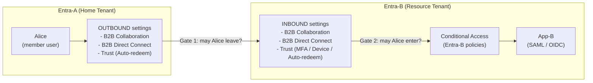
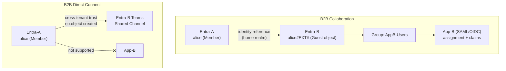
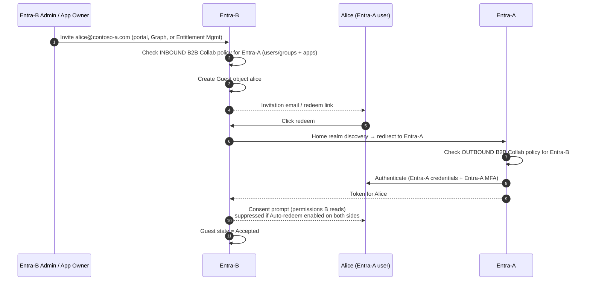
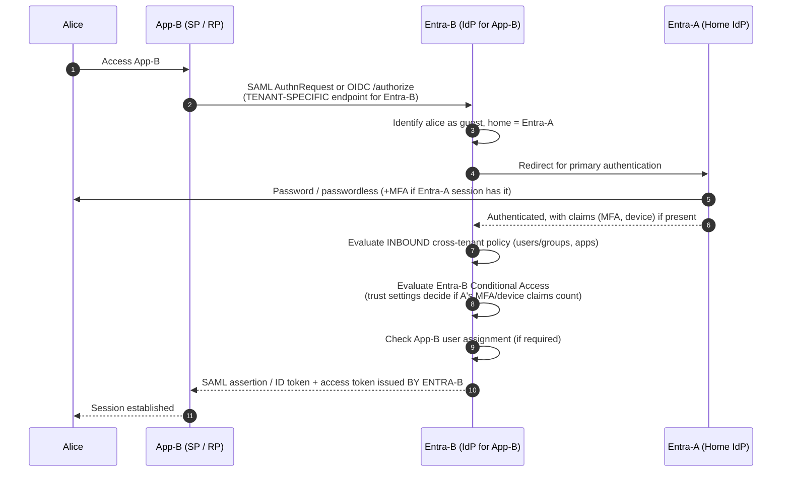
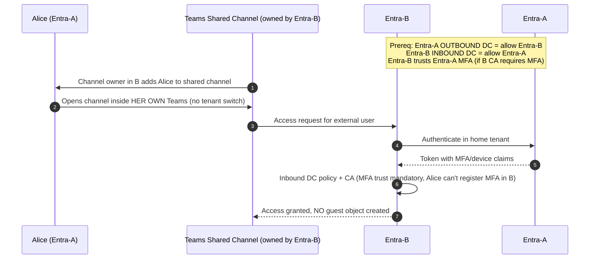
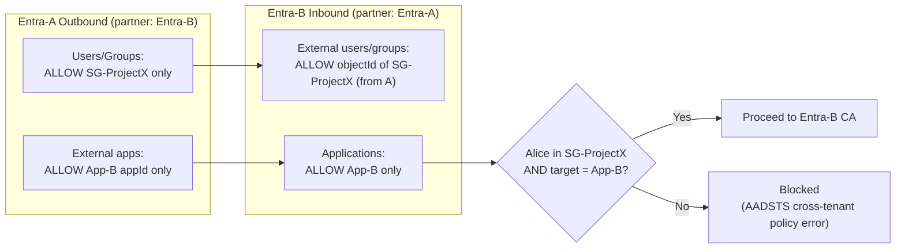
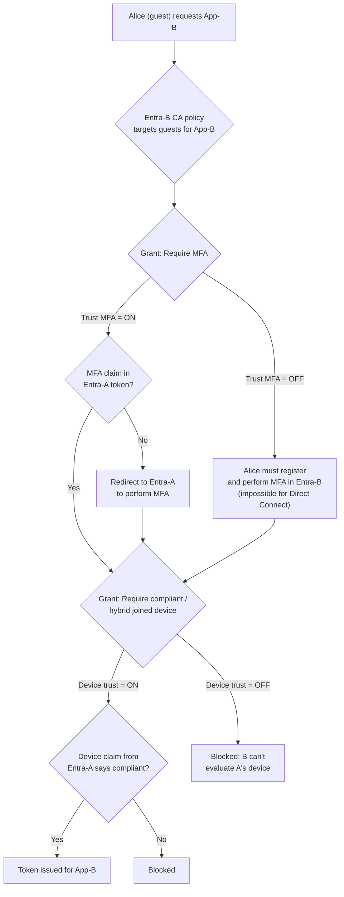
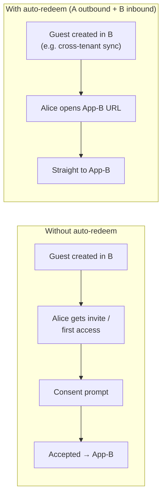
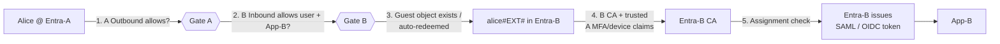

# Entra ID Cross-Tenant Access Settings: B2B Collaboration vs. B2B Direct Connect

**Scenario used throughout:**
- **Entra-A** is the home tenant, where the users live (`alice@contoso-a.com`).
- **Entra-B** is the resource tenant. It hosts **App-B**, which is integrated with Entra-B over SAML and/or OIDC.

---

## 1. The Mental Model: Two Gates, Both Must Open

Every cross-tenant setting has a direction. **Outbound** settings are configured on the user's home tenant and control where its users can go. **Inbound** settings are configured on the resource tenant and control who can come in.

**Effective access requires A's outbound setting AND B's inbound setting to both allow it. The most restrictive setting wins.**

| Setting layer | Scope |
|---|---|
| **Default settings** | Apply to every external Entra tenant |
| **Organizational settings** | Per-partner overrides, e.g. Entra-B adds Entra-A by tenant ID. These take precedence over the defaults. |

Out-of-box defaults:
- B2B Collaboration is **allowed** inbound and outbound.
- B2B Direct Connect is **blocked** both ways.
- All Trust settings are **off**.

---

## 2. B2B Collaboration vs. B2B Direct Connect

### High-level difference

| | **B2B Collaboration** | **B2B Direct Connect** |
|---|---|---|
| **Object in Entra-B** | A **guest user object** is created (`UserType=Guest`, UPN `alice_contoso-a.com#EXT#@b.onmicrosoft.com`) | **No object** in Entra-B. Alice stays external. |
| **Onboarding** | Invitation and redemption (or cross-tenant sync / self-service sign-up) | Mutual trust config only. No invite. |
| **Apps supported** | **Any app integrated with Entra-B**: SAML, OIDC/OAuth, M365, Azure portal, App Proxy | **Teams Connect shared channels only**, plus SharePoint/OneDrive files surfaced through those channels |
| **Configuration needed** | Works by default, one-sided invite | **Both tenants must explicitly enable** (A outbound + B inbound) |
| **Lifecycle / governance in B** | B manages the guest: groups, app assignment, access reviews, Entitlement Management, deletion | B cannot manage the user directly. Lifecycle is owned by A and by channel membership. |
| **Visibility in B** | Shows up in Users, sign-in logs, Graph | Not in B's directory. Activity appears in sign-in and audit logs, but there is no user object. |
| **MFA in B** | Guest can register MFA in B, or B can trust A's MFA | **Cannot register in B**, so B **must** trust A's MFA if B's CA requires it |
| **Typical use** | Contractors and partners accessing your line-of-business apps | Two orgs collaborating in a shared Teams channel without tenant switching |

> **For App-B (SAML/OIDC): only B2B Collaboration works.** B2B Direct Connect has no mechanism to issue a token for a custom enterprise app, because there is no principal in Entra-B to assign the app to or put in claims.

### Diagram: object model

---

## 3. B2B Collaboration Flow: Alice Accessing App-B

### 3a. Onboarding: invitation and redemption

### 3b. Runtime sign-in to App-B over SAML or OIDC

**Engineering gotchas for App-B:**

- **Endpoint.** App-B must use Entra-B's tenant-specific endpoint (`login.microsoftonline.com/<tenantB-id>/...`). A multi-tenant OIDC app hitting `/common` or `/organizations` signs Alice into **Entra-A** as a member, which is not a B2B guest flow at all.
- **Token issuer.** The SAML assertion and ID token are issued by **Entra-B**. App-B only ever trusts Entra-B, never Entra-A.
- **NameID and claims.**
  - `user.userprincipalname` for a guest yields the `#EXT#` UPN.
  - Use `user.mail` or a transformation if App-B keys off email.
  - `oid` in OIDC is the **guest object's ID in B**, not Alice's object ID in A.
  - Group claims come from Entra-B groups.
- **Conditional Access.** Entra-B's CA governs access to App-B. Entra-A's CA policies do **not** apply to resources in B, except for whatever claims A asserts and B chooses to trust.

---

## 4. B2B Direct Connect Flow: Teams Shared Channel Only

**When to use it:**
- Two organizations want ongoing channel collaboration without guest sprawl and without users switching tenants in Teams.
- Not for App-B, SharePoint sites outside the channel, Azure resources, or anything SAML/OIDC.

---

## 5. Inbound vs. Outbound Tabs: Users and Groups, Applications

Both B2B Collaboration and B2B Direct Connect expose the same two tabs. Their meaning flips depending on whether you are editing inbound or outbound.

| Where | Tab | Meaning in our scenario |
|---|---|---|
| **Entra-B Inbound** | **External users and groups** | Which of **Entra-A's** users and groups may come into B. You specify A's **object IDs**, because B cannot browse A's directory. Allow or block all, or specific ones. |
| **Entra-B Inbound** | **Applications** | Which of **B's own** apps those external users can reach, e.g. allow only App-B. In B2B Collab this is enforced at token issuance. |
| **Entra-A Outbound** | **Users and groups** | Which of **A's** users and groups may go out to B, e.g. only `SG-Partner-B-Access`. These are A's own groups, so they are browsable. |
| **Entra-A Outbound** | **External applications** | Which of **B's** apps A's users may access. Specified by app ID in B. |

### Example: lock it down to only Alice's team and only App-B

> **Caveat:** inbound group-based targeting relies on group membership claims in A's token. Very large or nested memberships can make results less predictable, so test with your actual group structure.

---

## 6. Trust Settings (Inbound, on Entra-B)

**The problem being solved:** Entra-B's Conditional Access often requires MFA and/or a compliant device for App-B. For an external user, that creates friction or makes the requirement impossible:
- **MFA:** Without trust, Alice must register a **second MFA method in Entra-B**. For Direct Connect this is impossible, so access is blocked.
- **Device:** Alice's laptop is enrolled in **Entra-A's Intune**. Entra-B has no record of it, so "require compliant device" **always fails** for guests without trust.

Trust settings tell Entra-B to **accept the claims A already asserted** in Alice's token.

| Trust setting | What Entra-B accepts from Entra-A | Example effect for App-B |
|---|---|---|
| **Trust multifactor authentication from Microsoft Entra tenants** | The MFA claim from A's authentication | B's CA "Require MFA for App-B" is satisfied by Alice's Entra-A MFA. No MFA registration in B. If A's session lacks MFA, Alice is sent back to **A** to perform it. |
| **Trust compliant devices** | Intune compliance claim evaluated by A | B's CA "Require compliant device" passes if Alice's laptop is compliant in **A's** Intune |
| **Trust Microsoft Entra hybrid joined devices** | Hybrid-joined device claim from A | B's CA "Require hybrid joined device" passes for Alice's domain-joined workstation in A |
| **Automatic redemption** | Suppresses the first-access consent prompt | See Section 7 |

### CA evaluation in Entra-B with trust

### Design implications

- **Trusting is a risk decision.** Trust MFA effectively outsources assurance to A's MFA policy. If A allows SMS while B demands phishing-resistant auth, you have a gap.
  - **Authentication strengths** in B's CA help here. Phishing-resistant strength can be satisfied by A's FIDO2 or CBA when MFA trust is enabled, but check which methods are honored cross-tenant before relying on it.
- **Device claims require supported clients and flows.** Browser SSO needs the device to present its identity, through Edge or Chrome with the Windows Accounts extension, or Company Portal/broker on mobile. Some SAML browser flows on unmanaged browsers won't carry device state.
- **Scope trust per partner.** Prefer enabling trust in **organizational settings for Entra-A only**, not in Default settings, which would trust every Entra tenant on the planet.

---

## 7. Automatic Redemption

| | |
|---|---|
| **What it does** | Suppresses the "Review permissions" consent prompt Alice sees the first time she accesses Entra-B |
| **Where** | **Both** sides: Entra-A **Outbound** → Trust settings → Automatic redemption, **and** Entra-B **Inbound** → Trust settings → Automatic redemption |
| **Applies to** | B2B Collaboration, B2B Direct Connect, and **Cross-Tenant Synchronization** |
| **Common pairing** | **Cross-tenant sync** (A provisions guests into B automatically) plus auto-redeem gives seamless multi-tenant-org access with no invite emails and no consent screen |

**Use case:** M&A or a conglomerate with multiple tenants. Divisions in A need routine access to App-B, and you want it to feel like a single org.

---

## 8. Putting It Together: Recommended Configuration for App-B

| Tenant | Setting | Value |
|---|---|---|
| **Entra-A** | Org setting for Entra-B → Outbound **B2B Collab** | Allow `SG-ProjectX` → External app: App-B |
| **Entra-A** | Outbound **B2B Direct Connect** | Leave blocked, unless Teams shared channels are needed |
| **Entra-A** | Outbound Trust → **Auto-redeem** | ✅, if B also enables it |
| **Entra-B** | Org setting for Entra-A → Inbound **B2B Collab** | Allow A's `SG-ProjectX` (object ID) → Applications: App-B |
| **Entra-B** | Inbound **Trust MFA** | ✅ |
| **Entra-B** | Inbound **Trust compliant / hybrid joined** | ✅, if B's CA requires device posture |
| **Entra-B** | Inbound **Auto-redeem** | ✅ |
| **Entra-B** | CA policy | Target *Guest or external users → Entra-A* for App-B. Require MFA (or an auth strength) and a compliant device. |
| **Entra-B** | App-B | Assignment required = Yes, assigned to a B group containing the guests. SAML NameID or OIDC claims mapped to `user.mail`. Tenant-specific endpoint. |
| **Entra-B** | Governance | Access reviews or Entitlement Management access package for the guests |

### End-to-end summary

---

## 9. Caveats Relevant to Federal and DoD Environments

- **Cross-cloud.** Collaborating between Azure Commercial and **Azure Government (GCC High/DoD)** requires enabling **Microsoft cloud settings** in cross-tenant access on both sides, then adding the partner as an organizational setting.
  - Cross-cloud supports **B2B Collaboration only**.
  - **B2B Direct Connect** is not supported cross-cloud.
- **Trust MFA and cross-cloud auth strengths.** Verify that the methods A uses will be honored by B's authentication strength policy. CAC/PIV via certificate-based auth in A is the case to test explicitly before relying on it for App-B.
- **Tenant restrictions v2** is a separate tab, and a separate control plane. It governs what **your users on your network/devices** can sign into in *other* tenants, including with external identities. It complements outbound settings but does not replace them.
- **Feature drift.** Direct Connect scope and cross-cloud support have changed over time, so check current Microsoft Learn docs before baking any of this into an ATO artifact.
