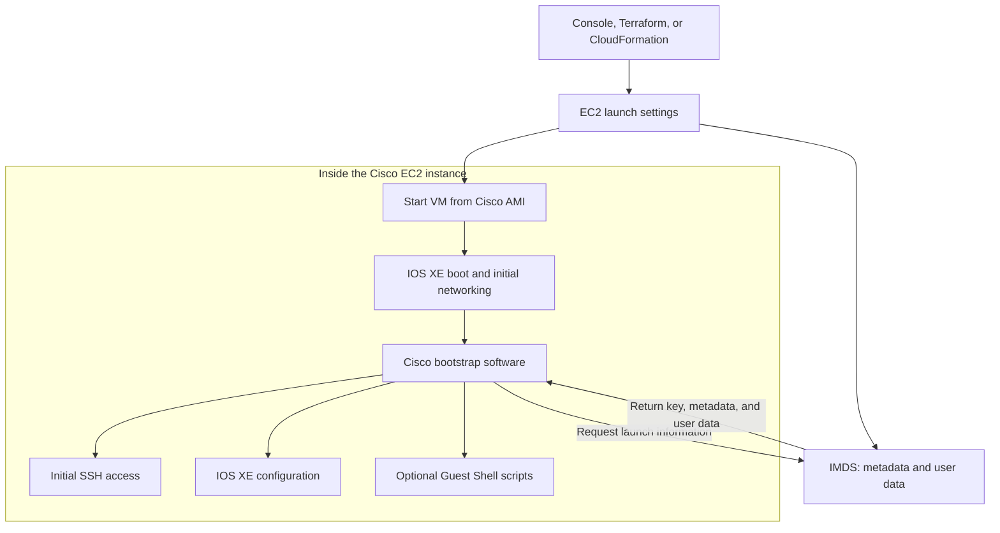
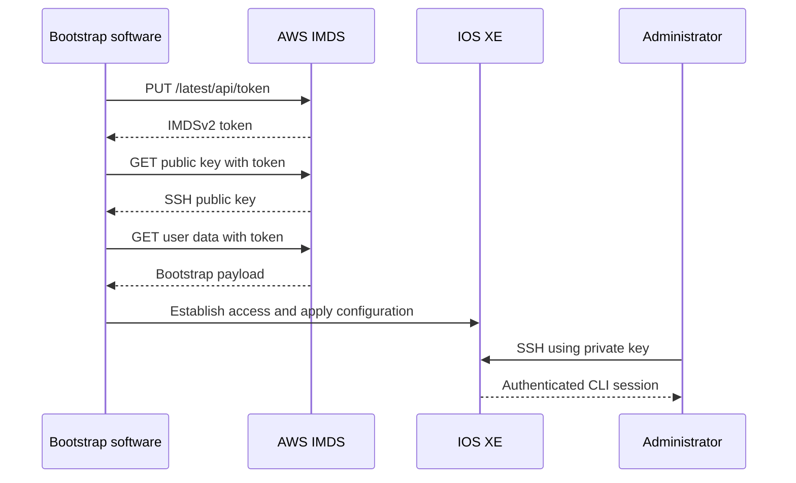

**AWS provides the launch information; software inside the image reads that information and configures the device.** On a typical Linux instance, that software is `cloud-init`. On Cisco virtual routers, Cisco’s image includes bootstrap logic that interprets the supported Cisco configuration formats.

I’ll focus on **Catalyst 8000V and CSR 1000V running IOS XE on EC2**. Other Cisco appliances can use different bootstrap mechanisms.

AWS treats user data as an opaque payload: the instance decides how to interpret it. AWS itself does not execute your IOS commands or shell script. [Amazon Elastic Compute Cloud](https://docs.aws.amazon.com/AWSEC2/latest/UserGuide/user-data.html?icmpid=docs_ec2_console\&utm_source=chatgpt.com)

The main components involved are:

| Component | Where it lives | What it does |
|---|---|---|
| **AMI** | AWS image catalog | Supplies the operating system, drivers, initial defaults, and bootstrap software. |
| **EC2 launch settings** | AWS control plane | Specify the AMI, instance type, interfaces, key pair, user data, and metadata options. |
| **ENI and initial networking** | AWS and the guest OS | Provide the network interface and connectivity needed during initialization. |
| **Instance Metadata Service — IMDS** | AWS, accessible locally from the instance | Makes instance information and user data available to software inside the instance. |
| **EC2 key pair** | Public key in AWS; private key held by you | Supplies the public key used to establish initial SSH access. |
| **Bootstrap software** | Inside the AMI | Retrieves launch information and applies configuration. |
| **IOS XE configuration engine** | Inside the Cisco router | Processes Cisco configuration commands. |
| **Guest Shell** | Optional execution environment inside IOS XE | Runs supported Python/Bash automation. |
| **IAM role / instance profile** | AWS | Supplies permissions when automation needs to call AWS APIs. |

Cisco documents both Day 0 configuration processing and Guest Shell automation. An attached IAM role serves a separate purpose: allowing software on the instance to obtain temporary AWS API credentials. [Cisco](https://www.cisco.com/c/en/us/td/docs/routers/C8000V/config/c8000v-installation-configuration-guide/day-0-configuration/day0-configuration-overview.html?utm_source=chatgpt.com)

This is the logical flow; the precise internal ordering varies by image and release:



**Metadata and user data contain different information.**

Metadata describes the instance. User data contains instructions or configuration that you supplied. Both are accessible through IMDS, normally at the link-local address `169.254.169.254`. [Amazon Elastic Compute Cloud](https://docs.aws.amazon.com/AWSEC2/latest/UserGuide/ec2-instance-metadata.html?utm_source=chatgpt.com)

| Information | Example endpoint |
|---|---|
| Instance ID | `/latest/meta-data/instance-id` |
| Primary private IPv4 address | `/latest/meta-data/local-ipv4` |
| Selected SSH public key | `/latest/meta-data/public-keys/0/openssh-key` |
| Your bootstrap payload | `/latest/user-data` |
| Attached role’s temporary credentials | `/latest/meta-data/iam/security-credentials/ROLE-NAME` |

The public key and role credentials are separate resources with different purposes. [Amazon Elastic Compute Cloud](https://docs.aws.amazon.com/AWSEC2/latest/UserGuide/configuring-instance-metadata-service.html?utm_source=chatgpt.com)

For example, selecting an EC2 key pair does **not** mean you must also paste that key into user data.

**Here is how the SSH key becomes usable.**

Suppose you launch a router with the key pair `network-admin`:

1. AWS makes that key pair’s **public key** available through the instance’s metadata.
2. The image’s initialization software retrieves the key and establishes the corresponding initial login access.
3. You connect using the matching **private key**.
4. The router verifies the SSH authentication locally.

Cisco documents `ec2-user` as the initial username for its AWS router AMIs:

```bash
ssh -i network-admin.pem ec2-user@10.20.1.10
```

Use an address reachable from your workstation; private connectivity can provide access to the private IP. The private key is not retrieved from metadata or uploaded to the router. [Amazon Elastic Compute Cloud](https://docs.aws.amazon.com/AWSEC2/latest/UserGuide/configuring-instance-metadata-service.html?utm_source=chatgpt.com)

On Amazon Linux, cloud-init normally installs the public key in the user’s `.ssh/authorized_keys`. Do not assume that the Cisco appliance exposes the same filesystem or uses the same administration commands. [Amazon Elastic Compute Cloud](https://docs.aws.amazon.com/AWSEC2/latest/UserGuide/user-data.html?icmpid=docs_ec2_console\&utm_source=chatgpt.com)

Also distinguish these two keys:

| Key | Purpose |
|---|---|
| Your EC2 login key pair | Lets the router authenticate **you**. |
| Router’s SSH host key | Lets your SSH client authenticate **the router**; this produces the host fingerprint prompt. |

After initialization, normal SSH login does not require fetching the EC2 key from metadata again for every connection.

**IMDSv2 adds a token exchange before retrieving the data.**

The bootstrap client first requests a token, then includes it in subsequent metadata requests. This token is separate from SSH keys and IAM credentials. [Amazon Elastic Compute Cloud](https://docs.aws.amazon.com/AWSEC2/latest/UserGuide/configuring-instance-metadata-service.html?utm_source=chatgpt.com)



**Image compatibility matters here.** Cisco documents IMDSv2 support for Catalyst 8000V starting with IOS XE **17.6.1**; the documented 17.4.x and 17.5.x releases use IMDSv1. Requiring IMDSv2 on an incompatible image can prevent it from retrieving its bootstrap information. [Cisco](https://www.cisco.com/c/en/us/td/docs/routers/C8000V/AWS/deploying-c8000v-on-amazon-web-services/deploy-c8000v-on-amazon-web-services.html?utm_source=chatgpt.com)

**What happens to a user data script depends on the image’s parser.**

On a Linux image with cloud-init, the initialization stages detect the platform, prepare networking, retrieve configuration, and run the appropriate modules. A user data shell script usually runs in the final stage, once per instance. [cloud-init 26.2 documentation](https://docs.cloud-init.io/en/latest/explanation/boot.html?utm_source=chatgpt.com)

For example:

```bash
#!/bin/bash
echo "Initialization completed" > /var/tmp/bootstrap-status.txt
```

Cloud-init recognizes the interpreter line and executes the script inside the Linux instance.

On Cisco IOS XE, use a format supported by that Cisco image. **A generic Linux `#!/bin/bash` payload should not be assumed to work as Cisco Day 0 configuration.**

Cisco terminology can be confusing:

| Term | Meaning |
|---|---|
| **EC2 User Data field** | AWS’s delivery mechanism for your payload. |
| **Cisco custom-data format** | A Cisco payload format with named sections. |
| **Cisco user-data format** | Another Cisco bootstrap format, used by established deployments. |
| **SD-WAN bootstrap** | A controller onboarding configuration generated for that deployment mode. |

Cisco recommends its **custom-data format** for most new Catalyst 8000V bootstrap deployments. You still place that content in the **AWS EC2 User Data field**. [Cisco](https://www.cisco.com/c/en/us/td/docs/routers/C8000V/config/c8000v-installation-configuration-guide/day-0-configuration/day0-configuration-overview.html?utm_source=chatgpt.com)

An illustrative autonomous-mode payload is:

```text
Section: IOS configuration
hostname EDGE-C8000V-01
interface Loopback100
 description Created-during-Day0
 ip address 192.0.2.100 255.255.255.255
```

The Cisco parser recognizes the section and submits its configuration commands to IOS XE. These lines are **IOS configuration**, not Bash commands. [Cisco](https://www.cisco.com/c/en/us/td/docs/routers/C8000V/config/c8000v-installation-configuration-guide/day-0-configuration/performing-day-0-configuration-using-custom-data.html?utm_source=chatgpt.com)

Older CSR documentation also shows numbered properties such as:

```text
ios-config-1="hostname EDGE-CSR-01"
ios-config-2="interface Loopback100"
ios-config-3="description Created-during-Day0"
```

Use the syntax documented for your image and release; these formats are alternatives, not interchangeable fragments. [Cisco](https://www.cisco.com/c/en/us/td/docs/routers/csr1000/software/aws/b_csraws/deploying_the_cisco_csr_1000v_on_amazon_web_services.html?utm_source=chatgpt.com)

For SD-WAN/controller mode, use the controller-generated bootstrap appropriate to that deployment. Cisco cautions against manually editing that generated configuration. [Cisco](https://www.cisco.com/c/en/us/td/docs/routers/C8000V/config/c8000v-installation-configuration-guide/day-0-configuration/day0-configuration-overview.html?utm_source=chatgpt.com)

**Guest Shell is where supported Cisco bootstrap scripts run.**

A custom-data payload can reference a script:

```text
Section: Script
https://bootstrap.example.org/router-bootstrap.py
```

In Cisco’s documented mechanism, the script executes in Guest Shell during first boot. It can be Python or Bash. Downloading it requires connectivity to the specified server; retrieving the user data payload from IMDS does not supply that external connectivity. [Cisco](https://www.cisco.com/c/en/us/td/docs/routers/C8000V/config/c8000v-installation-configuration-guide/day-0-configuration/performing-day-0-configuration-using-custom-data.html?utm_source=chatgpt.com)

If the script then downloads private S3 objects or updates AWS routes, that introduces another dependency: **AWS API authorization**. An instance profile can supply temporary credentials, but the script must use them through a supported SDK or client. Merely attaching an IAM role does not configure IOS XE or authorize SSH logins. [AWS Identity and Access Management](https://docs.aws.amazon.com/us_en/IAM/latest/UserGuide/id_roles_use_switch-role-ec2.html?utm_source=chatgpt.com)

Finally, several operational details explain common surprises:

| Observation | Explanation |
|---|---|
| Instance is running, but bootstrap is incomplete | VM startup and successful guest configuration are separate events. |
| Empty user data, yet initial SSH works | The selected key pair is supplied separately through metadata. |
| Linux script works on Amazon Linux but not Cisco | The images have different payload interpreters. |
| Updating user data does not change a running router | User data is not a continuous configuration synchronization service. |
| Bootstrap fetches metadata but cannot download a script | The external download has its own routing, DNS, and access requirements. |
| Configuration works until reboot | Verify the intended configuration is saved in startup-config; bootstrap rerun and persistence behavior are image-specific. |

By default, Linux user data scripts run at initial launch; changing the stored payload does not automatically rerun them. EC2 limits raw user data to **16 KB**, and Base64 encoding is transport encoding—not encryption. Avoid placing reusable private keys or long-lived credentials in it. [Amazon Elastic Compute Cloud](https://docs.aws.amazon.com/AWSEC2/latest/UserGuide/user-data.html?icmpid=docs_ec2_console\&utm_source=chatgpt.com)

**Which Cisco image and IOS XE release are you using—CSR 1000V or Catalyst 8000V, and autonomous or SD-WAN mode?** That determines the exact bootstrap format, persistence behavior, and troubleshooting commands.
