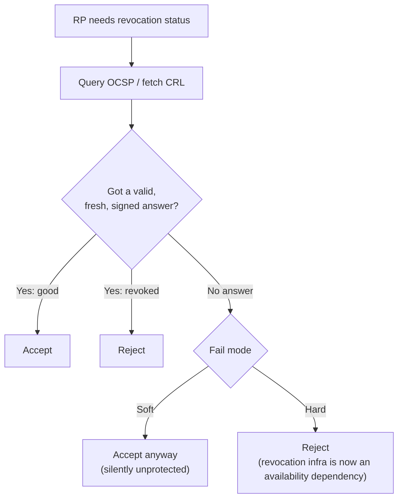

## 6.7 Soft-fail vs. hard-fail

When the relying party tries to check revocation, there are three possible outcomes. Two are unambiguous. The third, where the relying party couldn't get an answer at all, is where the fail mode matters.

| Revocation lookup result | Soft-fail | Hard-fail |
|---|---|---|
| **Good** (not revoked) | Accept | Accept |
| **Revoked** | Reject | Reject |
| **Unknown**: responder down, CRL unreachable or expired, timeout, firewall drop, captive portal, OCSP `unknown` | **Accept** (treat as good) | **Reject** (treat as revoked) |

Why the choice matters:

- **Soft-fail gives almost no protection against the threat revocation exists for.** Revocation matters when an attacker holds a stolen key for a revoked cert and is MITM-ing you. That attacker is already in the path, so they can drop your OCSP or CRL request (client → responder, :80), and soft-fail then accepts the revoked cert. That's the Chromium team's position: online checks are too unreliable to hard-fail, and nearly useless against most threats when soft-fail, because an active MITM can block the check.
- **Hard-fail is secure but makes the CA's infrastructure part of your uptime.** Any of these becomes an authentication outage for every user of that CA:
  - an OCSP responder outage;
  - an expired CRL that nobody republished;
  - a CRL too large to download in time;
  - a firewall rule blocking :80 egress.
- **Where each mode is typical:**
  - **Soft-fail:** public web browsing and most client libraries, where it's enabled at all.
  - **Hard-fail:** high-assurance authentication, where the relying party controls or co-manages the PKI. Examples are DoD CAC mTLS under STIG, Entra CBA with CRL configured (§6.10), Must-Staple, and Firefox with `security.OCSP.require`.

**What separates the two in a capture.** From the relying party's egress you'll see an OCSP or CRL request with no response, a TCP RST, or a SYN retransmit storm to the CA host on :80.
- **Soft-fail:** the TLS handshake still completes.
- **Hard-fail:** the RP sends a TLS alert, typically 44 `certificate_revoked`, 46 `certificate_unknown` or 45 `certificate_expired` depending on the stack, or closes the connection.

The packet pattern on the revocation leg is identical in both modes. Only the TLS outcome differs.

---
