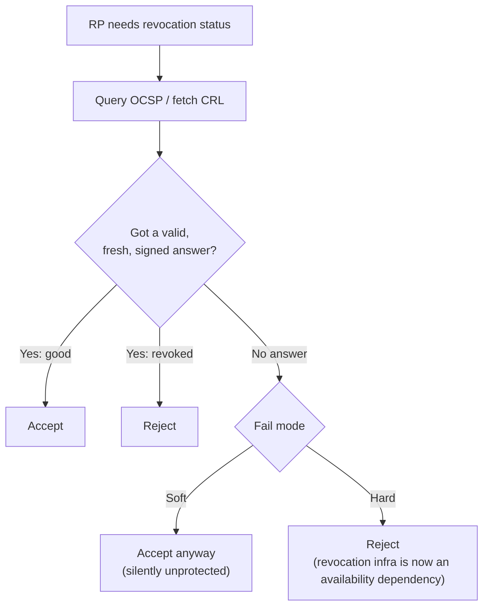
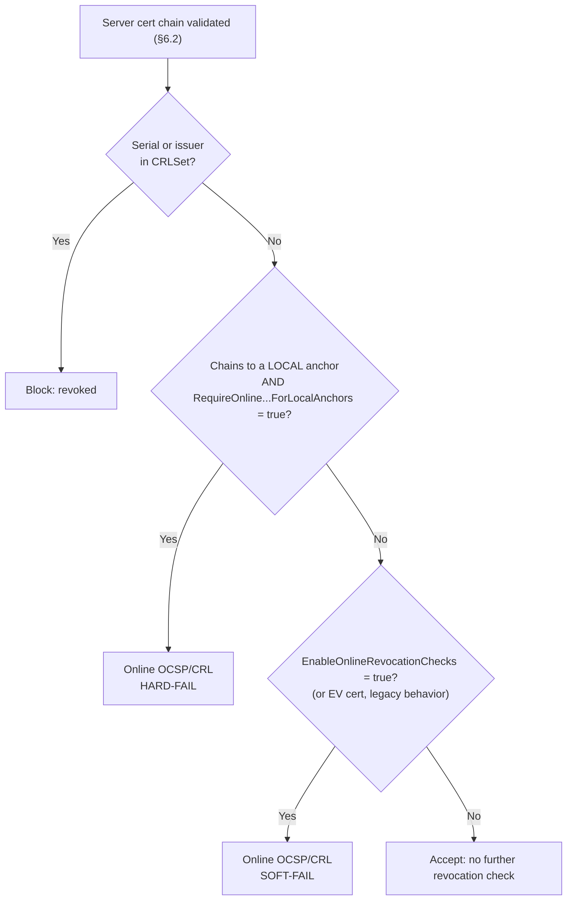
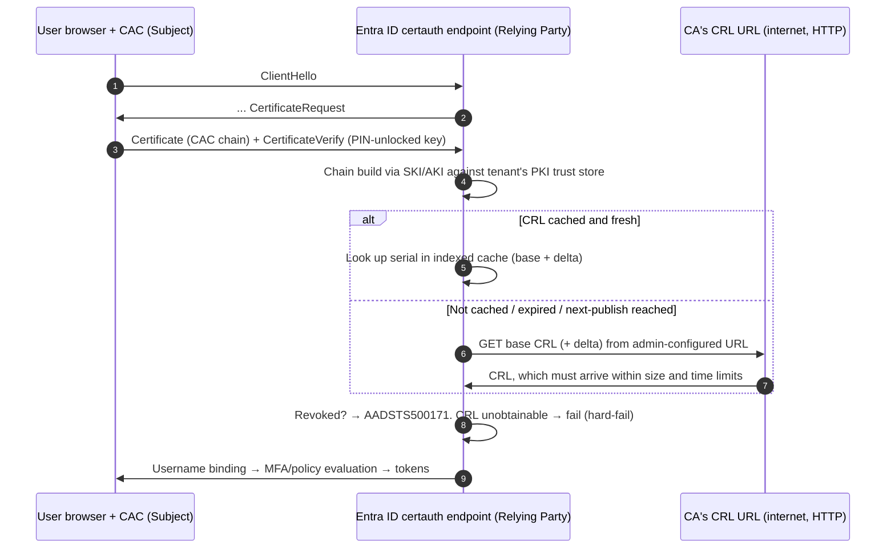

The additions below slot into the standalone Section 6:

- **New §6.7:** soft-fail vs. hard-fail. It goes after §6.6 (stapling), because the behavior tables that follow depend on these terms.
- **§6.8:** the old §6.7 (which method gets picked), with a replacement Chrome/Edge row and a new §6.8.1 explaining Chromium.
- **New §6.10:** Microsoft Entra CBA.

Old §6.8 (mTLS) becomes §6.9 unchanged, and old §6.9 (wire/CLI) becomes §6.11 with a few extra rows.

---

## 6.7 Soft-fail vs. hard-fail

When the relying party tries to check revocation, there are three possible outcomes. Two are unambiguous. The third, where the relying party couldn't get an answer at all, is where the fail mode matters.

| Revocation lookup result | Soft-fail | Hard-fail |
|---|---|---|
| **Good** (not revoked) | Accept | Accept |
| **Revoked** | Reject | Reject |
| **Unknown**: responder down, CRL unreachable or expired, timeout, firewall drop, captive portal, OCSP `unknown` | **Accept** (treat as good) | **Reject** (treat as revoked) |

Why the choice matters:

- **Soft-fail gives almost no protection against the threat revocation exists for.** Revocation matters when an attacker holds a stolen key for a revoked cert and is MITM-ing you. That attacker is already in the path, so they can drop your OCSP or CRL request (client → responder, :80), and soft-fail then accepts the revoked cert. That's the Chromium team's position: online checks are too unreliable to hard-fail, and nearly useless against most threats when soft-fail, because an active MITM can block the check.
- **Hard-fail is secure but makes the CA's infrastructure part of your uptime.** Any of these becomes an authentication outage for every user of that CA:
  - an OCSP responder outage;
  - an expired CRL that nobody republished;
  - a CRL too large to download in time;
  - a firewall rule blocking :80 egress.
- **Where each mode is typical:**
  - **Soft-fail:** public web browsing and most client libraries, where it's enabled at all.
  - **Hard-fail:** high-assurance authentication, where the relying party controls or co-manages the PKI. Examples are DoD CAC mTLS under STIG, Entra CBA with CRL configured (§6.10), Must-Staple, and Firefox with `security.OCSP.require`.

**What separates the two in a capture.** From the relying party's egress you'll see an OCSP or CRL request with no response, a TCP RST, or a SYN retransmit storm to the CA host on :80.
- **Soft-fail:** the TLS handshake still completes.
- **Hard-fail:** the RP sends a TLS alert, typically 44 `certificate_revoked`, 46 `certificate_unknown` or 45 `certificate_expired` depending on the stack, or closes the connection.

The packet pattern on the revocation leg is identical in both modes. Only the TLS outcome differs.

---

## 6.8 Which method the relying party uses when both CDP and AIA are present

The table is unchanged from the previous version except for the Chrome/Edge row, which is replaced with this:

| Relying-party software | Default revocation behavior | Preference when both URLs exist | Uses staples? |
|---|---|---|---|
| **Chrome / Edge (Chromium)** | Offline CRLSet check only (pushed list); **no per-connection OCSP/CRL** for normal certs | Determined by policy; see §6.8.1 | Yes, when present |

### 6.8.1 Chrome and Edge revocation behavior

**What "no online checks for normal certs" means.** During the handshake, Chrome does not contact the cert's OCSP responder or download its CDP CRL. The browser makes no outbound :80 request to the CA. Google switched this off deliberately: because soft-fail online checks provide no effective security benefit, Chrome disabled them by default starting with version 19. In 2018 the Edge team adopted the same behavior, skipping online OCSP and CRL checks for most certificates by default.

**What Chrome does instead: CRLSets.**
- A CRLSet is a small, Google-built blob of revoked certificate identifiers, pushed to the browser out of band: delivered through the Component Updater.
- Google builds it by aggregating CRLs from public CAs. The selection is curated and size-limited, mainly revoked intermediates plus high-impact leaves. Google's generation process is proprietary, and CRLSets are mainly a way for Chrome to block certificates quickly in emergencies.
- The check is local, so there's no handshake latency, no privacy leak to the CA, and nothing for a MITM to block at connection time.
- **Coverage is incomplete by design.** If the CRLSet doesn't include a given CA's CRL, Chrome will keep trusting that CA's certificates even if they've been revoked.
- You can view the installed version at `chrome://components` ("CRLSet").

**Where online checking still happens.** As of 2022, Chromium still did online OCSP/CRL checks for EV certificates only, in soft-fail mode. Treat that as version-dependent.

**The two enterprise policies:**

| Policy | Scope | Fail mode | What it does |
|---|---|---|---|
| `EnableOnlineRevocationChecks` | All server certs | **Soft-fail** | Turns on soft-fail revocation checking for certificates, so Chrome fetches OCSP/CRL per the cert's AIA/CDP. Unreachable → accept |
| `RequireOnlineRevocationChecksForLocalAnchors` | Only server certs chaining to a **locally installed root** | **Hard-fail** | If revocation status can't be obtained, the certificate is treated as revoked; with the policy on, Edge always checks server certificates that validate and are signed by locally installed CA certificates |

**"Local anchor."** A root CA trusted because it's installed in the OS or enterprise trust store, not because it ships in Chrome's or Microsoft's built-in public root program. DoD Root CA 3/5/6 and enterprise AD CS roots are local anchors.

What this means for your environment:

- **DoD-PKI-issued server certs get effectively no revocation checking in Chrome or Edge by default.** They chain to local anchors, and Google's CRLSet generally won't cover DoD issuing CAs. A revoked internal server cert keeps working in the browser.
- **`RequireOnlineRevocationChecksForLocalAnchors` is the policy that fixes this.** The trade-off is that every workstation now needs reachability to DISA OCSP/CRL endpoints, or to your internal repeaters, on :80. If that path breaks, users get hard failures on internal sites.
- **Platform caveat:** Edge's documentation lists Windows support from version 123, and on macOS the policy does nothing if `MicrosoftRootStoreEnabled` is False. Check the current Chrome and Edge policy docs for your platform and versions.
- **These policies govern only the browser validating *server* certs.** They have nothing to do with how a server validates the browser's CAC certificate (§6.9).

---

## 6.10 Microsoft Entra CBA: Entra as the relying party

In Entra certificate-based authentication, the user's browser presents a client certificate (CAC/PIV/soft cert) in an mTLS handshake to Entra's certificate-auth endpoint. **Entra is the relying party**, running path validation and revocation checks in Microsoft's cloud. Your workstation's CryptoAPI settings, browser policies and OCSP repeaters play no part in this check.

### Key behaviors

**Where Entra gets the CRL URL**
- Authentication Policy Administrators set the CRL distribution point when they configure each trusted issuer in the tenant, and each issuer's CRL must be reachable at an internet-facing URL.
- The URL comes from the tenant configuration, not by trusting whatever the user cert's CDP extension says.

**OCSP**
- **Not supported.** Microsoft says it doesn't support OCSP for performance and reliability reasons. Entra instead downloads the CRL at first sign-in, caches it, and indexes the cache for fast lookups.
- Your DoD OCSP responders and OCSP repeaters are irrelevant to Entra CBA.

**Fail mode: hard-fail when a CRL is configured**
- If a CRL is configured for the trusted issuer and Entra can't download it (availability, size or latency), user CBA fails, which Microsoft itself calls a critical single point of failure.

**No CRL configured: no check at all**
- If the administrator doesn't configure a CRL, Entra performs no CRL checks during CBA.
- Close that gap with the **Require CRL validation** setting. With it on, CBA fails when the user cert's issuing CA has no CRL configured. Specific CAs can be exempted.

**Base and delta CRLs, freshness, replay protection**
- With only a base CRL, Entra caches it until Next Update, and authentication fails if it has expired and can't be refreshed. Entra also requires every new CRL to carry a higher CRL Number than the previous one, which prevents replaying an old CRL.
- When both base and delta are configured, both must be valid and reachable; if either is missing or expired, validation fails.

**Size and time limits (relevant to large DoD CRLs)**
- The interactive-sign-in download limit is 20 MB in Azure Global (including GCC) and 45 MB in Azure US Government (including GCC High and DoD). The background service download limit is 65 MB and 150 MB respectively.
- The download must finish within 10 seconds.
- Above the interactive limit, the first sign-in fails while Entra retries in the background at the higher limit.

**Chain depth**
- Entra checks CRLs for the issuing CA and the rest of the chain up to the root, capped at 10 CAs from the leaf.

**PKI prerequisites**
- Entra builds chains using SubjectKeyIdentifier rather than SubjectName, so PKI configurations need SKI and AKI values for revocation checking to work.

**Network path**
- The CRL fetch comes from Microsoft's cloud egress, not from your enclave. The URL must be publicly reachable, and any IP allow-listing on the CRL host must permit Azure ranges. Microsoft attributes most 403 download failures to firewall rules, fixable by allowing the relevant Azure IP ranges and service tags.
- HTTP is recommended over HTTPS for the CRL URL, to reduce latency and avoid the circular dependency of validating a cert in order to fetch a CRL.

**Revocation latency**
- Because of caching, revocation is not instant. A newly revoked cert isn't detected until the cache refreshes, so Microsoft recommends also revoking all of the affected user's sessions when you revoke a certificate.
- Use `Revoke-MgUserSignInSession` or the `StsRefreshTokensValidFrom` mechanism for immediate cutoff.

**Stapling**
- Not involved. Entra doesn't request client-side stapling, and CAC middleware couldn't supply it anyway (§6.9).

### Entra CBA vs. the other relying parties in this section

| | Entra CBA | ALB mTLS (verify) | nginx / Apache client-cert | Windows / IIS (CryptoAPI) |
|---|---|---|---|---|
| Relying party location | Microsoft cloud | AWS-managed LB | Your server | Your server |
| OCSP | No | No | Optional | Preferred |
| CRL | Yes: admin-configured URL, fetched and cached by Entra | Yes: you upload to S3 | Yes: local file | Yes: from the cert's CDP, fallback |
| Fail mode | Hard (when configured) | Hard against the uploaded CRL. No fetch, so freshness is your job | Configurable | App-dependent |
| Who must reach the CRL host | Microsoft egress → internet | Nobody (you push the CRL to S3) | Your server | Your server |

---

## 6.11 Wire and CLI reference: additional rows

| Goal | Filter / command |
|---|---|
| Soft-fail signature: revocation request unanswered but handshake completed | `(ocsp \|\| http.request.uri contains ".crl") && !http.response` alongside a completed `tls.handshake.type == 20` on the same client |
| Hard-fail outcome | `tls.alert_message.desc in {44 45 46}` following an unanswered revocation request |
| Check Chrome/Edge policy state | `chrome://policy` / `edge://policy` |
| Check CRLSet version | `chrome://components` → "CRLSet" |
| Check CRL size against Entra limits | `curl -sI <CRL URL> \| grep -i content-length` |
| Check CRL Number, Next Update and AKI (must match the CA's SKI) | `openssl crl -inform DER -in x.crl -noout -crlnumber -nextupdate -ext authorityKeyIdentifier` (older OpenSSL: `-text`) |
| Windows: inspect a CRL | `certutil -dump x.crl` |
| Windows: test CDP/AIA reachability | `certutil -url <cert>` |

Sources:
- [Microsoft Entra CBA – Certificate Revocation List (Microsoft Learn)](https://learn.microsoft.com/en-us/entra/identity/authentication/concept-certificate-based-authentication-certificate-revocation-list)
- [Certificate Revocation in Microsoft Edge (Eric Lawrence)](https://textslashplain.com/2022/08/01/certificate-revocation-in-microsoft-edge/)
- [RequireOnlineRevocationChecksForLocalAnchors (Microsoft Edge policy docs)](https://learn.microsoft.com/en-ie/deployedge/microsoft-edge-browser-policies/requireonlinerevocationchecksforlocalanchors)
- [Google Chrome STIG draft V-0037 (STIG Viewer)](https://www.stigviewer.com/stig/google_chrome_draft/2012-09-25/finding/V-0037)
- [How Do Browsers Handle Revoked SSL/TLS Certificates? (SSL.com)](https://ssl.com/article/how-do-browsers-handle-revoked-ssl-tls-certificates/)
- [Certificate revocation in Google Chrome (Scott Helme)](https://scotthelme.co.uk/certificate-revocation-google-chrome/)
