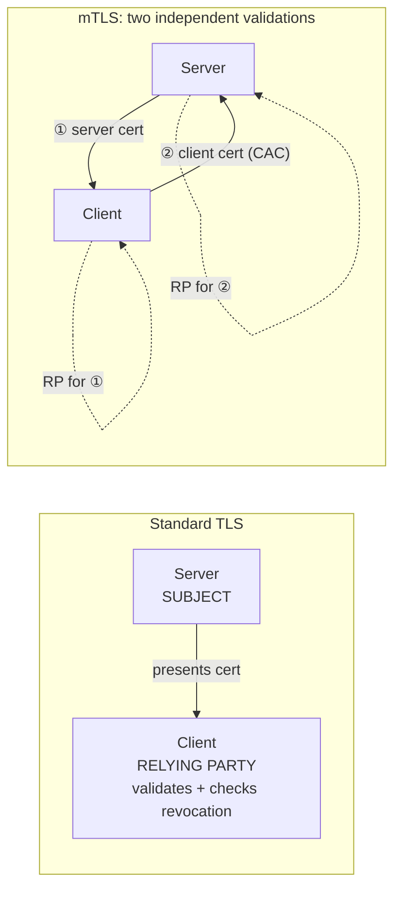
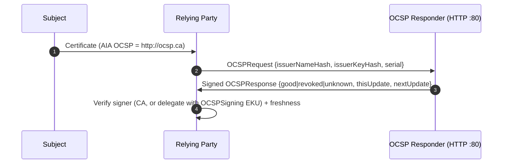
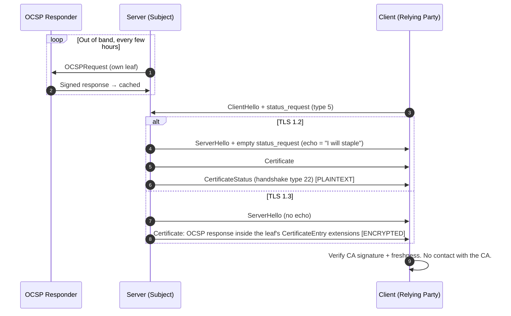
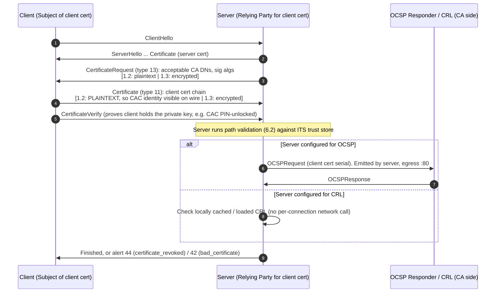

# 6. PKI Certificate Validation and Revocation

## 6.1 Terminology and roles

A certificate always involves three parties. The **relying party** is whoever receives a certificate and must decide whether to trust it. "Relying party" is a role, not a box: whichever side is doing the verifying holds it.

| Role | Definition | Standard TLS (HTTPS) | mTLS (two certificate validations) |
|---|---|---|---|
| **Subject** (cert holder) | Owns the private key; presents the cert | Server | Server for its cert; **client** for its cert (e.g. CAC/PIV) |
| **Issuer** (CA) | Signed the cert; publishes revocation info | Public or private CA | DoD PKI, enterprise CA, etc. |
| **Relying party** (verifier) | Receives the cert, validates it, decides trust | **Client** (browser, curl, SDK) | Client validates the server cert; **server** validates the client cert |
| **Validation endpoints** | Revocation data sources run on behalf of the CA | CRL distribution point (HTTP), OCSP responder (HTTP) | Same, often via local OCSP repeaters or CRL caches in enclaves |



Everything below about which method gets used is decided by the relying party's software and configuration. The CA only publishes revocation data. The subject can only hand over a stapled response. Neither can force the relying party to check.

## 6.2 Path validation (local checks, no network)

For each cert in the chain, the relying party checks:
1. The signature verifies with the issuer's public key.
2. The validity dates cover the current time.
3. The leaf's name matches: the SAN for servers, or an identity mapping for clients.
4. Issuer certs have BasicConstraints CA:TRUE and respect any pathLen limit.
5. KeyUsage and EKU fit the role: `serverAuth` for a server cert, `clientAuth` for a client cert.
6. The chain ends at an anchor in the relying party's trust store.

Revocation is a separate, optional check that needs network access or cached data. **"SSL certificate verify ok" in curl (OpenSSL backend) means steps 1–6 only.**

## 6.3 What is in the cert vs. what is negotiated in the handshake

| Item | Where it lives | Who sets it | What it means |
|---|---|---|---|
| CRL URL | Cert: **CRL Distribution Points** extension (2.5.29.31) | CA, at issuance | "My revocation list is published here" |
| OCSP URL | Cert: **Authority Information Access** extension (1.3.6.1.5.5.7.1.1), `id-ad-ocsp` | CA, at issuance | "Ask this responder about this serial" |
| Must-Staple | Cert: **TLS Feature** extension (1.3.6.1.5.5.7.1.24, RFC 7633) | CA, at the subject's request | "Reject me if no stapled OCSP response is presented" |
| "Please staple" request | **Handshake only**: `status_request` extension (type 5) in ClientHello | Relying-party software | "If you have a cached OCSP response, send it" |
| Stapled OCSP response | **Handshake only** (see 6.6) | Subject's TLS software (nginx, ALB, IIS…) | CA-signed status, fetched in advance by the subject |

The answer to "how does a client know stapling is supported" follows from this table:

- **The certificate does not advertise stapling support.** No extension says "this server staples."
- **The client always asks blindly** (if its software supports stapling) by putting `status_request` in its ClientHello.
- **The server either answers or stays silent.** It answers with a response or ignores the request. A missing staple is not an error, unless the cert carries Must-Staple.
- **Stapling indirectly depends on the cert.** The server can only fetch a staple if the cert has an AIA OCSP URL. Certs issued without one, such as Let's Encrypt certs since 2025, cannot be stapled at all.

## 6.4 CRL: bulk list, pull model

The CA publishes a signed list of revoked serial numbers. The relying party downloads the whole list and checks whether the cert's serial is on it.

```mermaid
sequenceDiagram
    autonumber
    participant CA as CA
    participant CDP as CRL server (HTTP :80)
    participant RP as Relying Party
    participant SUB as Subject
    CA->>CDP: Publish signed CRL (thisUpdate, nextUpdate, revoked serials)
    SUB->>RP: Certificate (CDP = http://crl.ca/x.crl)
    alt not cached, or past nextUpdate
        RP->>CDP: GET /x.crl
        CDP->>RP: DER CRL (KB to tens of MB)
    end
    RP->>RP: Verify CRL signature; serial listed? → reject
```

| Pros | Cons |
|---|---|
| Cacheable, works offline or air-gapped, can be pre-staged | Large lists (DoD CRLs are notably large) |
| Private: the CA doesn't learn which cert is being checked | Stale until the next publish (hours to days) |
| One download covers every cert from that issuer | First-fetch latency |

## 6.5 OCSP: per-cert query, pull model

The relying party asks the responder about one certificate and gets a signed answer.



| Pros | Cons |
|---|---|
| Small, fresh | Privacy: the responder sees what is being validated, in real time |
| | Extra round trip to a third party inside the handshake |
| | Responder down or blocked → hard-fail (outage) or soft-fail (no protection) |

## 6.6 OCSP stapling: the subject pre-fetches, the relying party verifies

The subject fetches an OCSP response for its own cert ahead of time and hands it over during the handshake. The response is CA-signed and time-bounded, so the subject cannot forge it. The relying party trusts the CA's signature, not the server.



How the relying party learns a staple is present:
- **TLS 1.2:** the server echoes `status_request` in ServerHello, then sends a CertificateStatus message.
- **TLS 1.3:** the response simply appears attached to the leaf in the Certificate message.

## 6.7 When the cert has both a CRL URL and an OCSP URL: who picks?

The relying party's software picks. RFC 5280 does not mandate an order. In practice:

| Relying-party software | Default revocation behavior | Preference when both URLs exist | Uses staples? |
|---|---|---|---|
| **curl + OpenSSL** (Linux, most builds) | **None.** OpenSSL does not fetch CRLs or OCSP on its own | Neither. Only `--crlfile` (local CRL) or `--cert-status` (stapled only) | Only with `--cert-status`, which then hard-fails if missing or bad |
| **curl + Schannel** (Windows) | On, via CryptoAPI | OCSP first, CRL fallback | Yes, via Schannel |
| **Windows CryptoAPI / Schannel** (IIS, .NET, Edge legacy, PowerShell) | On | OCSP preferred. After repeated OCSP lookups against the same CA it switches to downloading the CRL (`CryptnetCachedOcspSwitchToCrlCount`, default 50); CRL fallback if OCSP is unreachable | Yes |
| **Chrome / Edge (Chromium)** | **No online checks** for normal certs. Uses Google-pushed CRLSets | N/A by default. Enterprise policies `EnableOnlineRevocationChecks` (soft-fail) and `RequireOnlineRevocationChecksForLocalAnchors` (hard-fail for private roots) turn on online checking | Accepts staples where present |
| **Firefox** | CRLite (pushed, compressed all-revocations set; rolled out to desktop in 2025), with OCSP as legacy/fallback | **Never fetched CDP CRLs** historically. OCSP only, now CRLite-first | Yes |
| **Java (JSSE/PKIX)** | Off (`com.sun.net.ssl.checkRevocation=false`) | When enabled: OCSP preferred, CRL fallback. Tunable via `PKIXRevocationChecker` (`PREFER_CRLS`, `NO_FALLBACK`, `SOFT_FAIL`) | Yes (client-side status_request) |
| **Go `crypto/tls`** | None | Neither (implement yourself) | Exposes the staple; does not verify it |
| **Python `ssl`/requests, Node** | None (OpenSSL-based) | Local CRL only if loaded and `VERIFY_CRL_CHECK_*` is set | No built-in verification |

Rules of thumb:
- **Staple first.** If present and valid, nothing else is needed.
- **OCSP over CRL** for online checkers (Windows, Java), because it's small and fresher.
- **CRL when offline or at volume.** Pre-staged or cached, or after the Windows switch threshold.
- **The public web is moving to CRL.** The CA/B Forum made CRLs mandatory and OCSP optional, and major CAs are dropping OCSP. Browsers increasingly consume CRLs indirectly through pushed aggregates (CRLSets, CRLite) instead of per-connection lookups.

These defaults change across versions and builds. Verify the specific client in your environment, especially the curl backend: check `curl -V` for `OpenSSL` vs `Schannel`.

## 6.8 mTLS: the server becomes the relying party



### Does the server software decide? Yes, completely.

| Server / service | Client-cert revocation options |
|---|---|
| **nginx** | `ssl_crl` (local file). `ssl_ocsp on\|leaf` + `ssl_ocsp_responder` + `ssl_ocsp_cache` (nginx ≥ 1.19.0). Note: `ssl_stapling` is for its *own* cert, which is unrelated |
| **Apache httpd** | `SSLCARevocationFile/Path` + `SSLCARevocationCheck chain\|leaf`. `SSLOCSPEnable on\|leaf`, `SSLOCSPDefaultResponder`, `SSLOCSPOverrideResponder` |
| **IIS / Windows** | CryptoAPI, same logic as 6.7 (OCSP preferred, CRL fallback); configurable via `netsh http` cert-binding revocation flags |
| **HAProxy** | `crl-file` on the `bind` line. `ocsp-update` is for its own staple, not client certs |
| **Envoy** | CRL in `validation_context`. No OCSP for peer validation; `ocsp_staple_policy` is for its own cert |
| **AWS ALB mTLS (verify mode)** | **CRL only**, uploaded to S3 and attached to the trust store. **No OCSP.** You own CRL refresh automation. Confirm GovCloud parity for your region |
| **AWS ALB mTLS (passthrough mode)** | ALB does no validation. It forwards the chain in the `X-Amzn-Mtls-Clientcert` header, so **the backend is the relying party** |
| **API Gateway mTLS** | S3 trust store, **no native revocation check**. Use a Lambda authorizer to do OCSP/CRL |

### Is OCSP stapling used for client cert verification?

Effectively no.

- **TLS 1.2:** impossible. `status_request` only flows client→server, and there is no message for a client to staple.
- **TLS 1.3:** the spec allows it. The server can put `status_request` in its CertificateRequest, asking the client to attach an OCSP response to its Certificate message (RFC 8446 §4.4.2.1).
- **In practice:** essentially no client stacks support this. That includes browsers and CAC/PIV middleware such as ActivClient and OS smartcard providers. Mainstream servers and AWS services don't request it either.

So in mTLS the **server always does its own online OCSP or CRL check**. That has several consequences in DoD/CAC environments:

- **Server egress, not client egress, needs reach** to DISA OCSP/CRL endpoints, or to a local OCSP repeater or CRL cache. Capture on the server's egress to see it.
- **Per-handshake OCSP adds latency and a dependency.** Caching (`ssl_ocsp_cache`) or CRL-based checking is standard.
- **Hard-fail is typically required** by STIG for CAC authentication, so responder or CRL availability becomes an availability dependency of your application.

## 6.9 Wire and CLI reference

| Goal | Filter / command |
|---|---|
| Client requests a staple (client → server) | `tls.handshake.type == 1 && tls.handshake.extension.type == 5` |
| Stapled response, TLS 1.2 (server → client) | `tls.handshake.type == 22` |
| Server asks for a client cert | `tls.handshake.type == 13` (1.3 needs keylog) |
| Client cert sent (filter on client source IP) | `tls.handshake.type == 11 && ip.src == <client>`. In 1.2 the CAC cert is readable in the capture |
| Online OCSP (relying party → responder, :80) | `ocsp` |
| CRL download | `http.request.uri contains ".crl"` |
| Revocation rejection | `tls.alert_message.desc == 44` |
| Read CDP / AIA / Must-Staple from a cert | `openssl x509 -in c.pem -noout -ext crlDistributionPoints,authorityInfoAccess,tlsfeature` |
| See whether a server staples | `openssl s_client -connect host:443 -servername host -status </dev/null 2>/dev/null \| grep -A5 "OCSP response"` ("no response sent" = no staple) |
| Manual OCSP check (any cert, including a client cert) | `openssl ocsp -issuer int.pem -cert leaf.pem -url "$(openssl x509 -in leaf.pem -noout -ocsp_uri)" -resp_text` |
| Manual CRL check | `openssl verify -crl_check -CAfile chain.pem -CRLfile crl.pem leaf.pem` |
| Test mTLS with curl | `curl -v --cert client.pem --key client.key https://host` |
| curl: require a staple | `curl --cert-status https://host` |
| Identify curl's TLS backend | `curl -V` |
